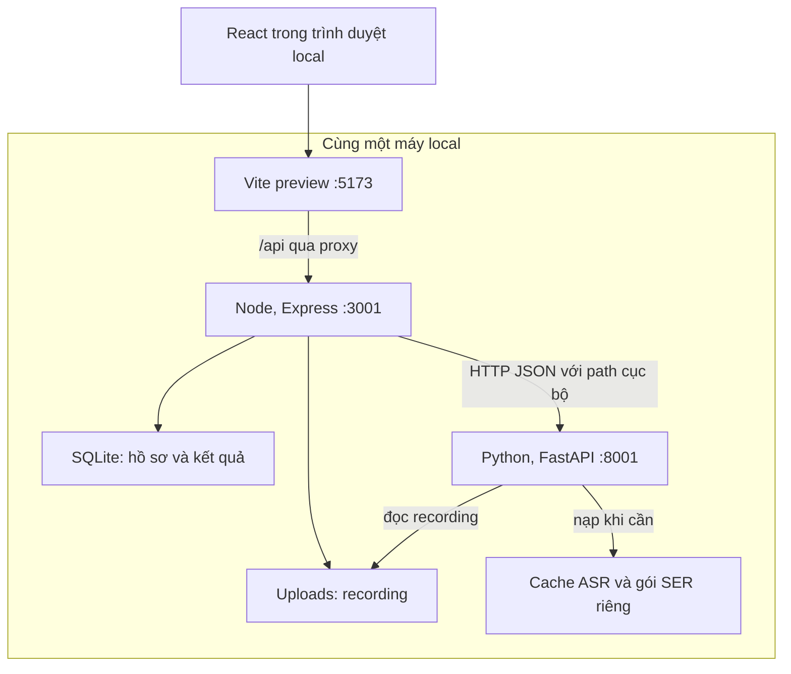
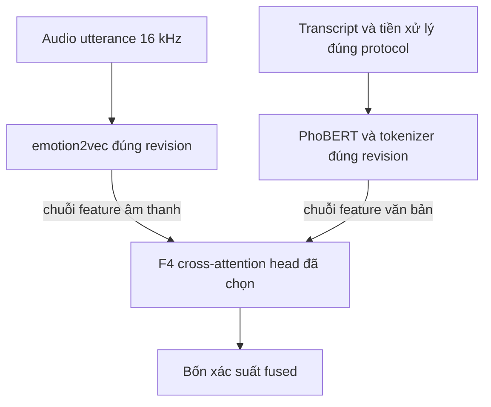
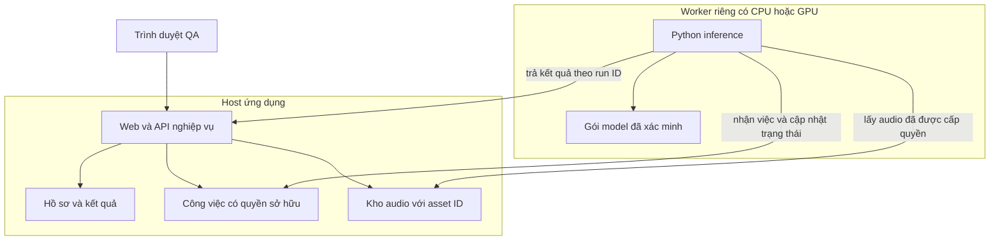

# ISEmoTalk — kiến trúc nghiệp vụ, mô hình và triển khai

Ngày đối chiếu: **23/11/2026**. Tài liệu mô tả kiến trúc ứng dụng đã kiểm tra tại commit `68891da04e0db6834f26409b0209aa7c71aa91cd`, cùng hướng hoàn thiện đã chọn cho đợt sửa khởi động local. Mục có nhãn **Đề xuất** chưa phải tính năng đã triển khai. Các lệnh chạy và xử lý lỗi terminal nằm trong [DEMO_RUNBOOK.md](DEMO_RUNBOOK.md).

**Quyết định hiện tại:** giữ React/TypeScript cho giao diện, Node/Express cho nghiệp vụ, Python/FastAPI cho suy luận; hoàn thiện một cấu hình SER thật và đo trên laptop trước khi quyết định thuê máy hay đổi ngôn ngữ. Nút thắt nghiên cứu hiện nay là khôi phục đúng encoder, tiền xử lý và factory của SER. Việc tìm thấy checkpoint, đổi sang Rust hoặc trỏ URL tới VPS chưa giải quyết nút thắt đó. [Thiết kế đợt sửa](superpowers/specs/2026-11-23-local-startup-architecture-design.md), [kiểm toán inference](audits/inference-research-20261122.md).

## 1. Ứng dụng phục vụ ai và giải quyết việc gì?

ISEmoTalk hỗ trợ **QA xem xét cuộc gọi tiếng Việt sau khi cuộc gọi kết thúc**. Đầu ra nghiệp vụ là hồ sơ có recording, timestamp, transcript, dự đoán với nguồn rõ ràng, quyết định của người đánh giá và hành động xử lý tiếp. Người dùng cần tìm đoạn đáng nghe lại, kiểm tra vì sao hệ thống gợi ý đoạn đó, rồi ghi nhận kết luận dựa trên bằng chứng.

| Tác nhân | Việc cần làm | Ranh giới hiện tại |
|---|---|---|
| Nhân viên tiếp nhận/nhập dữ liệu | Đưa recording và thông tin cuộc gọi vào hệ thống | Upload file; có thể nhập transcript hoặc kết quả đã tính trước |
| Người đánh giá QA | Nghe lại, đối chiếu transcript/người nói, xác nhận hoặc sửa nhãn, ghi chú | Giao diện review và lưu bản sửa theo version đã có |
| Người phụ trách xử lý vụ việc | Ghi ticket, việc tiếp theo, người phụ trách, hạn phản hồi và kết quả | Hồ sơ workflow đã có; các giá trị do người dùng nhập |
| Người nghiên cứu/vận hành model | Chọn gói model, kiểm tra nguồn gốc, đánh giá đầu ra và tài nguyên | Adapter và cổng kiểm chứng đã có; full SER F4 chưa được phục hồi |
| Tổng đài/CRM bên ngoài | Cung cấp recording, mã liên hệ và trạng thái ticket | Chưa có kết nối PBX, webhook hay đồng bộ CRM trong mã hiện tại |

Một người có thể đảm nhiệm nhiều vai trò trong demo. Đây là vai trò nghiệp vụ, **chưa phải các nhóm quyền đăng nhập**: bản local chưa có cơ chế xác thực danh tính reviewer. Các endpoint và form hiện có được thể hiện tại [API ứng dụng](../server/src/app.ts), [review](../server/src/review.ts), [workflow](../server/src/workflow.ts) và [các trang giao diện](../src/App.tsx).

### Ví dụ xuyên suốt: khách hỏi khoản hoàn tiền bị chậm

Đây là **kịch bản minh họa**, không phải dữ liệu khách hàng hoặc kết quả model đã đo.

1. Khách gọi vì khoản hoàn tiền chưa về. Nhân viên kiểm tra và hẹn phản hồi. Sau cuộc gọi, người phụ trách xuất recording từ hệ thống đang sử dụng và tải vào ISEmoTalk.
2. ISEmoTalk cấp một ID nội bộ, chẳng hạn `CALL-0012`. Người dùng nhập tên nhân viên, ngày gọi; mã liên hệ ngoài hệ thống và mã ticket được bổ sung trong hồ sơ xử lý nếu đã biết.
3. ASR tạo transcript có mốc thời gian. Nếu một câu như “Tôi đã chờ nhiều ngày rồi” bị nhận sai, QA có thể nghe đúng đoạn để sửa. Nếu recording mono chưa biết ai nói, QA phải kiểm tra và gán vai trước khi diễn giải các chỉ số riêng cho khách hàng.
4. Khi có SER thật đã được xác minh, hệ thống có thể gợi ý một đoạn có nhãn tiêu cực để QA nghe lại. Với cấu hình SER mock hiện nay, đoạn gợi ý chỉ minh họa thao tác; không được dùng để kết luận khách thực sự có cảm xúc đó.
5. QA nghe cả lời khách và lời nhân viên, ghi nhận lời hẹn có rõ ràng hay không, xác nhận/sửa nhãn hoặc đánh dấu gợi ý không hữu ích. Cảm xúc dự đoán không tự xác định lỗi của nhân viên hay tính đúng sai của khoản hoàn tiền.
6. Nếu cần theo dõi tiếp, người dùng đặt `resolution=follow_up`, nhập `owner`, `nextAction` và `followUpAt`. Sau khi có thông tin xử lý thực tế, người dùng ghi `outcomeNote` và chuyển sang `resolved`. Ứng dụng hiện không tự gọi lại, gửi thông báo hoặc kiểm tra giao dịch hoàn tiền.
7. Hồ sơ được xuất JSON/CSV để kiểm tra lại; các quyết định QA vẫn tách khỏi dự đoán model.

Các ràng buộc khi hẹn xử lý tiếp hoặc đóng vụ việc nằm trong [workflow](../server/src/workflow.ts); việc giữ text/người nói gốc, nhãn QA và dự đoán nằm trong [repository](../server/src/repo.ts) và [review](../server/src/review.ts).

## 2. Dữ liệu và định danh: cái gì đã có trong schema?

Các tên trả ra API thường dùng camelCase; SQLite chủ yếu dùng snake_case. Bảng dưới đây ánh xạ tới chỗ lưu **thực tế**, tránh hiểu nhầm một trường trong form là một thực thể CRM hoàn chỉnh.

| Khái niệm | API hoặc giá trị minh họa | Chỗ lưu hiện tại và ý nghĩa |
|---|---|---|
| Cuộc gọi trong ứng dụng | `id`, tham số route `callId`; `CALL-0012` | `calls.id`; bộ đếm `id_counters` cấp ID bền vững, không tái dùng chỉ vì đã xóa một cuộc gọi |
| Câu nói | `u0001`, `u0002`… | Khóa ghép `utterances(call_id, id)`; một `u0001` chỉ có nghĩa khi biết cuộc gọi nào |
| Recording | `audioUrl`, `audioName` | `calls.audio_file` là đường dẫn tương đối dưới thư mục uploads; chưa có bảng asset hoặc `audioAssetId` riêng |
| Mã liên hệ ngoài hệ thống | `externalContactId` | Thuộc JSON `call_workflows.fields_json`; nhập tay, chưa có ràng buộc duy nhất theo nhà cung cấp hoặc chống webhook trùng |
| Mã vụ việc/ticket | `ticketId` | Cũng thuộc `fields_json`; chưa có bảng ticket hoặc lịch sử CRM liên kết nhiều cuộc gọi |
| Queue, lý do, việc tiếp theo | `queueName`, `reason`, `nextAction`, `owner`… | Các trường trong `fields_json`, không phải các cột tương ứng trong bảng `calls` |
| Phiên bản review | `version`, request `baseVersion` | `calls.version`; phát hiện một bản review đã bị cập nhật nơi khác và trả lỗi 409 |
| Phiên bản hồ sơ xử lý | `workflow.version`, request `baseVersion` | `call_workflows.version`, độc lập với review; lịch sử ở `workflow_events` |
| Khoảnh khắc gợi ý | Ví dụ `escalation:u0004` | ID được suy ra từ loại gợi ý và câu neo; đánh giá của QA ở `moment_reviews`, có `evidence_key` để nhận ra bằng chứng đã đổi |
| Tiến độ suy luận | `stageLog`, `attempts` | JSON `calls.stage_log` và `calls.attempts`; chưa có bảng job hay `inference_run_id` riêng |
| Danh tính model đã dùng | `stageLog[].evidence` | Ghi adapter, model nếu có, device nếu có, mock, verified nếu có; chưa ghi digest đầy đủ của package cho mỗi lần chạy |

Nguồn: [schema SQLite](../server/src/db.ts), [ánh xạ DTO và allocator](../server/src/repo.ts), [workflow JSON và lịch sử](../server/src/workflow.ts), [stage evidence](../server/src/domain.ts).

### Ba loại trạng thái độc lập

| Trạng thái | Giá trị hiện có | Câu hỏi nó trả lời |
|---|---|---|
| Xử lý tính toán: `status` | `queued`, `processing`, `ready`, `failed` | Đã xử lý xong dữ liệu hay chưa? |
| Đánh giá QA: `reviewStatus` | `unreviewed`, `in_progress`, `reviewed` | Người đánh giá đã xem và lưu kết luận tới đâu? |
| Giải quyết vụ việc: `resolution` | `unassessed`, `open`, `follow_up`, `resolved` | Vấn đề nghiệp vụ đã được theo dõi/xử lý thế nào? |

`ready` không tự chuyển thành `reviewed`. Một nhãn `happy` hoặc `neutral` cũng không tự chuyển vụ việc thành `resolved`. Khi sửa transcript/người nói, dự đoán cũ vẫn được giữ và đánh dấu đầu vào đã thay đổi; **chưa có chạy lại SER theo phiên bản transcript**. Nút retry hiện chỉ tiếp tục cuộc gọi bị `failed`, không phải thao tác tái suy luận một hồ sơ đã review. [Trạng thái và nhãn](../server/src/domain.ts), [review](../server/src/review.ts), [retry](../server/src/app.ts).

## 3. Kiến trúc đang chạy: ba dịch vụ trên cùng một máy



Diagram mô tả các tiến trình và đường dữ liệu, không có nghĩa mỗi hộp là một máy hoặc VPS. React chạy trong trình duyệt; Vite phục vụ các file web. Node và Python là hai tiến trình riêng cùng truy cập recording trên ổ đĩa.

| Tầng | Công nghệ và phần việc | Mã nguồn |
|---|---|---|
| Giao diện | TypeScript, React, Tailwind; điều hướng, form, audio player, transcript, biểu đồ và trạng thái | [package.json](../package.json), [src/App.tsx](../src/App.tsx) |
| Phục vụ web local | Vite preview phục vụ bản đã build; chuyển `/api` tới Node | [vite.config.ts](../vite.config.ts) |
| API nghiệp vụ | TypeScript chạy bằng Node, Express; upload, ID, lưu dữ liệu, review, workflow và export | [server/src/app.ts](../server/src/app.ts) |
| Điều phối | Hàng đợi tuần tự trong tiến trình Node, checkpoint stage vào SQLite | [server/src/pipeline.ts](../server/src/pipeline.ts) |
| Dữ liệu | `better-sqlite3`, SQLite WAL; audio lưu thành file riêng | [server/src/db.ts](../server/src/db.ts), [config](../server/src/config.ts) |
| API suy luận | Python, FastAPI, Uvicorn; kiểm tra audio, điều phối adapter | [inference/app/main.py](../inference/app/main.py), [service.py](../inference/app/service.py) |
| Tính toán ML | ASR faster-whisper/CTranslate2; adapter PhoWhisper tùy chọn dùng Transformers/PyTorch; SER thật sẽ do factory nghiên cứu cung cấp | [adapters](../inference/app/adapters/__init__.py) |

Chạy build chỉ tạo file web, không giữ các dịch vụ sống. Trình duyệt có HTML chưa chứng minh proxy/API/inference đang hoạt động; API sống cũng chưa chứng minh có dịch vụ web lắng nghe cổng 5173. Đợt sửa startup kiểm tra các thành phần này riêng. Cách khởi động, giữ terminal mở và đọc lỗi nằm trong [runbook](DEMO_RUNBOOK.md).

### Một recording đi qua hệ thống như thế nào?

`POST /api/calls/upload` lưu file, tạo record `queued`, đưa ID vào hàng đợi và trả HTTP 202. Người dùng xem tiến độ trong khi Node gọi các endpoint Python theo thứ tự. [Upload API](../server/src/app.ts), [pipeline](../server/src/pipeline.ts).

| Stage | Xử lý thực tế | Kết quả lưu hoặc sử dụng |
|---|---|---|
| `validate` | Probe metadata, kiểm tra giới hạn, giải mã có budget, tạo peaks | Thời lượng, số kênh, waveform peaks; lỗi nếu file không hợp lệ |
| `transcribe` | ASR từ audio thành text có timestamp; stereo đủ tin cậy được xử lý theo kênh | Danh sách utterance, nguồn người nói và nguồn ASR |
| `diarize` | Giữ vai đã có; thử adapter khi còn `unknown` | Nhãn vai được cung cấp/có căn cứ, hoặc giữ `unknown` |
| `emotion` | Cắt đúng đoạn utterance, truyền waveform 16 kHz, text và speaker vào SER | Mỗi câu có fused prediction; acoustic/lexical có thể null |
| `finalize` | Áp dụng quy tắc tổng hợp trên đầu ra | Priority, chỉ số cảm xúc, khoảnh khắc gợi ý |

Python trả JSON; Node kiểm tra schema, timestamp, confidence và coverage ID trước khi lưu. Output của stage và dấu hoàn tất được ghi trong cùng transaction. Sau restart, các record `queued`/`processing` được lấy lại, những stage đã hoàn tất được giữ. Đây là cơ chế tiếp tục công việc của một tiến trình API, chưa phải hàng đợi phân tán. Hủy request phía Node ngăn ghi kết quả muộn; không bảo đảm ngắt ngay phép tính ML đồng bộ đang chạy bên Python. [Inference client](../server/src/inference/client.ts), [pipeline](../server/src/pipeline.ts).

### Người nói, cảm xúc và “khoảnh khắc quan trọng”

Với stereo thực sự tách hai người sang hai kênh, `agentChannel` cho biết kênh của nhân viên. Với mono, `diarization=none` để vai chưa biết cho QA gán. Adapter pyannote tùy chọn có thể tìm cụm người nói, nhưng API hiện chỉ mang vai `agent/customer/unknown`; code không suy người nói đầu tiên là nhân viên và vẫn để vai unknown nếu chưa có căn cứ. [Service stereo](../inference/app/service.py), [diarization](../inference/app/adapters/diarization.py).

`finalize` dùng **quy tắc ứng dụng**, không gọi thêm một LLM hoặc model đánh giá nhân viên. Logic hiện lấy diễn biến cảm xúc khách đã xác định vai, tỷ lệ thời gian tiêu cực, chuyển nhãn, đoạn tiêu cực kéo dài và bất đồng modality để gợi ý review. Khi thiếu vai khách, không có cơ sở tổng hợp các chỉ số riêng cho khách. Khi thiếu đầu acoustic/lexical, không có cơ sở tính bất đồng giữa hai đầu đó. Những ngưỡng trong code là heuristic cần đánh giá bằng dữ liệu nghiệp vụ. [derive, detectMoments và priorityScore](../server/src/domain.ts).

### Ba đường đưa dữ liệu vào

| `source` | Đầu vào | Những stage cần chạy |
|---|---|---|
| `upload` | Recording | Toàn bộ pipeline; một stage có thể được bỏ qua có lý do, chẳng hạn đã có vai từ kênh |
| `transcript_import` | Recording + transcript timestamp | Validate → gán vai nếu cần → emotion → finalize; bỏ qua ASR; prediction nhúng trong transcript bị bỏ |
| `results_import` | Kết quả JSON/CSV, audio tùy chọn | Validate nếu có audio → finalize; bỏ qua ASR/diarization/SER; provenance là `imported` |

Nhập kết quả đã tính trước có thể hữu ích cho demo hoặc nghiên cứu, nhưng không được trình bày như model vừa chạy trên recording trong buổi đó. [Import và upload](../server/src/app.ts), [planStages](../server/src/pipeline.ts).

## 4. Model, môi trường Python và dữ liệu nằm ở đâu?

| Thành phần | Vị trí mặc định/cách chọn | Nó chứa gì? |
|---|---|---|
| Code web/API | `src/`, `server/`; bản build trong `dist/` | Mã giao diện và nghiệp vụ; không phải model weights |
| Môi trường Python | `inference/.venv`; có thể chọn executable khác bằng `ISEMO_PYTHON` | Python và package như FastAPI, faster-whisper, CTranslate2; thêm dependency SER khi đã xác định đúng |
| Chọn adapter | `inference/.env` và biến môi trường | `ISEMO_ASR`, `ISEMO_SER`, `ISEMO_DIARIZATION`, model path/device/budget |
| Model ASR trên đĩa | `ISEMO_ASR_MODEL` là thư mục local hoặc snapshot có sẵn trong cache | `model.bin`, cấu hình, tokenizer và các asset cần cho CTranslate2 |
| Hugging Face cache | Thường là `%USERPROFILE%\.cache\huggingface\hub` trên Windows | Snapshot model; có thể đổi bởi `HF_HOME` hoặc `HF_HUB_CACHE` |
| Gói SER nghiên cứu | Đường dẫn riêng do `ISEMO_SER_CONFIG` chỉ tới | Factory code, checkpoint, encoder, tokenizer, metadata, preprocessing và manifest hash |
| Recording | `server/data/uploads/` nếu không đổi `ISEMO_DATA_DIR`; phía Python dùng `ISEMO_UPLOADS_DIR` | File upload theo thư mục cuộc gọi; hai tiến trình cần đọc đúng cùng vị trí |
| SQLite | `server/data/isemotalk.db` nếu không đổi `ISEMO_DATA_DIR` | Hồ sơ, transcript, prediction, review, workflow, stage log; WAL/SHM có thể có khi đang chạy |
| RAM/VRAM | Bộ nhớ của tiến trình khi dịch vụ hoạt động | Model đã nạp, PCM, feature, tensor trung gian và workspace tính toán |

Nguồn trong dự án: [Node config](../server/src/config.ts), [Python config](../inference/app/config.py), [Python launcher](../scripts/run-python.mjs), [ASR cache resolver](../inference/app/adapters/asr_faster_whisper.py), [SER package contract](SER_PACKAGE_VERIFICATION.md). Theo [Hugging Face](https://huggingface.co/docs/huggingface_hub/package_reference/environment_variables), cache Hub mặc định là `$HF_HOME/hub`, còn `HF_HOME` mặc định ở `~/.cache/huggingface`; phải kiểm tra các override trên máy đang chạy.

### `.venv` không phải máy ảo và không tự chứa mọi model

`.venv` tách interpreter/package Python của dự án khỏi các môi trường khác. Nó không cấp thêm CPU/GPU, không tự biến thành server và không phải nơi bắt buộc lưu weights. Nhiều môi trường có thể trỏ tới cùng cache trên đĩa. Khi chuyển sang máy/OS khác, cần tạo môi trường tương thích tại nơi mới; không mặc định copy nguyên `.venv` Windows sang Linux. [Tài liệu Python venv](https://docs.python.org/3/library/venv.html).

Một môi trường Python có thể phục vụ nhiều model nếu dependency tương thích. Nếu các package nghiên cứu xung đột phiên bản, có thể tách môi trường hoặc tiến trình; việc đó chưa đòi hỏi mỗi model một VPS. Yêu cầu quan trọng là code và dependency của gói được chọn phải tái lập được, không cài thêm thư viện theo phỏng đoán.

### Dung lượng đĩa, RAM và VRAM là ba ngân sách khác nhau

Weights lưu trên SSD chỉ chiếm dung lượng đĩa. Khi model được nạp, tiến trình cần RAM và có thể cần VRAM nếu chọn GPU; trong lúc xử lý còn có tensor trung gian. File checkpoint nhỏ không có nghĩa tổng model chạy nhỏ, vì checkpoint có thể chỉ là classifier phía cuối.

Trong code hiện tại, ASR và SER được nạp khi dùng lần đầu rồi giữ ở `_model`. **Hàng đợi tuần tự không tự giải phóng model giữa các stage**: sau khi đã khởi tạo, weights của nhiều thành phần vẫn có thể cùng nằm trong bộ nhớ. Muốn unload/offload theo stage cần triển khai và đo riêng. Cache một recording giúp tránh giải mã lặp, nhưng budget PCM 256 MiB không bao gồm model hoặc mọi allocation tạm. [ASR adapter](../inference/app/adapters/asr_faster_whisper.py), [checkpoint adapter](../inference/app/adapters/ser_checkpoint.py), [audio cache](../inference/app/service.py).

Thông tin đã có về laptop là RTX 3050 Laptop 4 GiB và dung lượng trống từng được báo khoảng 7 GB; đây là **ràng buộc lịch sử**, không phải phép đo hiện tại. ASR CPU INT8 là điểm xuất phát đã từng chạy được, giúp tránh tranh VRAM với SER; nó vẫn dùng CPU và RAM. Chưa có bằng chứng full F4 sẽ vừa 4 GiB với mọi độ dài đầu vào. Trước khi cài thêm backbone, cần đo lại dung lượng trống và kiểm kê asset đang có. [Trạng thái phục hồi và giới hạn đo](audits/inference-research-20261122.md), [thiết lập ASR](OFFLINE_ASR_SETUP.md).

## 5. Trạng thái thật của các thành phần ML

### ASR và SER giải quyết hai việc khác nhau

ASR trả lời “đã nói gì”; SER dự đoán một trong bốn nhãn `neutral`, `happy`, `sad`, `angry` cho utterance. Real ASR không biến SER mock thành thật. Repo mặc định mock; cấu hình laptop được ghi nhận trước đây sử dụng faster-whisper-small thật trên CPU, còn SER mock. Tài liệu này không phải một lần xác nhận mới rằng tiến trình laptop đang sống. [Settings](../inference/app/config.py), [OFFLINE_ASR_SETUP.md](OFFLINE_ASR_SETUP.md).

Adapter faster-whisper dùng cache local, không tự tải model; cấu hình CPU dùng INT8, một worker và bốn CPU threads mặc định. Trong code, ngôn ngữ là `vi`, beam size 3; các giá trị này là cấu hình hiện tại, chưa phải cấu hình được chứng minh tối ưu. Đây là `Systran/faster-whisper-small`, **khác PhoWhisper-base** được pin trong text axis của nguồn nghiên cứu đã kiểm tra. [ASR implementation](../inference/app/adapters/asr_faster_whisper.py), [đối chiếu nghiên cứu](audits/inference-research-20261122.md).

### Đọc health theo từng thành phần

| Trường | Ý nghĩa đúng | Chưa chứng minh điều gì? |
|---|---|---|
| `ready` | Adapter đáp ứng điều kiện cấu hình/phụ thuộc mà kiểm tra hiện tại yêu cầu | Chưa chắc đã nạp model hoặc xử lý thành công một recording |
| `loaded` | Với adapter có trường này: model đã được khởi tạo trong tiến trình đó | Chưa phải latency, accuracy hoặc mức dùng RAM/VRAM |
| `verified` | Với checkpoint: gói đáp ứng cổng kiểm chứng được mô tả trong contract | Không phải tái lập mọi kết quả paper hoặc accuracy tổng đài |
| `mock` | Thành phần có tạo đầu ra mô phỏng hay không | `mock=false` không tự bảo đảm chất lượng nghiệp vụ |
| `mode` toàn dịch vụ | Tổng hợp `mock/real/mixed` từ các adapter | `diarization=none` vẫn là thành phần không mock; mode không có nghĩa mọi khả năng đều có |

`warmup` hiện chỉ nạp ASR faster-whisper từ cache. Health không tự chạy inference; còn cần một recording để kiểm tra đường thực thi. Trường `device` tổng dịch vụ ưu tiên mô tả ASR CTranslate2 khi chọn faster-whisper, không thay phép đo GPU của toàn bộ factory SER. [Health và warmup](../inference/app/service.py), [checkpoint status](../inference/app/adapters/ser_checkpoint.py), [giải thích verification](SER_PACKAGE_VERIFICATION.md).

## 6. Paper liên quan tới kiến trúc ứng dụng thế nào?

Cơ sở đối chiếu là paper **Acoustic–Lexical Reliance in Vietnamese Speech Emotion Recognition Across Speaker and Corpus Shifts** và nguồn nghiên cứu đã được ghi nhận trong [kiểm toán inference](audits/inference-research-20261122.md). Các link source private, revision, kích thước feature và lineage đầy đủ nằm trong báo cáo đó; kiến trúc dưới đây không thay một lần tái lập thực nghiệm.

| Họ nghiên cứu | Cấu trúc và tài sản cần có | Liên hệ với ứng dụng |
|---|---|---|
| F1 / RQ1 | XLS-R + XLM-R, các model linear và scaler đã fit đúng protocol | So sánh thông tin từ các modality khi thực sự có head tương ứng; giữ đánh giá tách người nói |
| B2 / RQ2 | emotion2vec + TF-IDF + logistic fusion; cần scaler, vocabulary, IDF và classifier đã fit | Transcript là một đầu vào có thể gây thay đổi prediction; sửa text phải giữ nguồn và đánh dấu kết quả cũ |
| F4 / RQ3, các thí nghiệm H5 | emotion2vec frames + PhoBERT tokens + cross-attention fusion | Gói triển khai phải chứa đúng feature pipeline và head; cần đánh giá riêng khi chuyển sang cuộc gọi |

F1, B2 và F4 là **ba họ mô hình**, không lần lượt là ba cột acoustic, lexical và fused trong giao diện. Cột nào có prediction phải có model thật tạo ra prediction đó. Head F4 trong archive có một classifier hợp nhất; không có hai classifier độc lập để tự điền acoustic/lexical. [Các nguồn nghiên cứu đã đối chiếu](audits/inference-research-20261122.md).

### Đường suy luận F4 cần phục hồi — chưa hoàn tất



Factory phải tái tạo đúng resampling, cách cắt/padding, feature precision, tokenization và truncation của model gốc. Adapter web chỉ truyền waveform mono float32 16 kHz của đoạn được yêu cầu, text và speaker; nó không thể suy ra những quy tắc nghiên cứu đó từ tên `model.pt`. Các xác suất phải hữu hạn, đúng bốn lớp và đúng thứ tự nhãn khai báo. Acoustic/lexical không có thì trả `None`. [Contract adapter](../inference/app/adapters/base.py), [factory loader](../inference/app/adapters/ser_checkpoint.py), [hướng dẫn package](SER_PACKAGE_VERIFICATION.md).

Ở ranh giới hiện tại, factory trả vector xác suất nhưng `to_prediction()` chuyển thành **nhãn cao nhất + confidence** trước khi trả HTTP; SQLite cũng chỉ lưu cặp đó cho từng đầu. Không được giả định đã có toàn bộ vector hoặc mọi feature trong dữ liệu export. Nếu nghiên cứu ứng dụng cần phân tích phân bố, phải bổ sung lưu trữ có phiên bản. [to_prediction](../inference/app/adapters/base.py), [service](../inference/app/service.py), [schema](../server/src/db.ts).

### Chín checkpoint không có nghĩa phải chạy chín model đầy đủ

Archive đã được kiểm tra chứa chín head H5: M0/C0/M1 × seed 13/42/2026; tổng bytes các head khoảng 49,75 MiB. Đây là các file `model.pt` của head, chưa gồm toàn bộ pretrained emotion2vec/PhoBERT. Hash model/metadata đã khớp record lịch sử, nhưng việc kiểm tra bytes không phải chạy suy luận. Các head tháng 10 cũng không tự đại diện cho mọi lần chạy sensitivity với feature mới tháng 11. [Inventory và giới hạn lineage](audits/inference-research-20261122.md).

**Đề xuất triển khai:** bắt đầu bằng một gói SER hoạt động có condition/seed được chọn theo protocol hoặc validation đã định trước. Lưu các checkpoint còn lại làm tài sản nghiên cứu. Nếu dùng ensemble thì định nghĩa rõ tập head và phép kết hợp; không chọn seed bằng cách xem kết quả test hoặc chỉ chọn ví dụ demo đẹp.

Các head có thể chia sẻ encoder/feature **khi** dùng cùng frozen weights, revision, preprocessing và input. Khi ấy có thể tính feature một lần rồi chạy nhiều head. Đây là tối ưu đề xuất, chưa có trong factory web hiện tại. Không mặc định chia sẻ giữa F1/B2/F4 chỉ vì tên model có phần giống nhau; pooled feature và temporal feature cũng có thể khác contract. Nếu encoder được fine-tune khác nhau, chỉ dùng một encoder sẽ làm đổi model.

### Inference, training và tái lập paper là các nhiệm vụ khác nhau

| Nhiệm vụ | Đầu vào và kết quả cần có |
|---|---|
| Phục vụ inference | Model đã chọn, code/asset tiền xử lý, recording và transcript; trả prediction, không cập nhật weights |
| Training/continuation | Dữ liệu và nhãn, split/protocol, optimizer và cập nhật weights; tạo checkpoint mới |
| Tái lập thực nghiệm | Khôi phục đúng lineage, dữ liệu/split, feature, seeds, ngân sách và cách đánh giá để đối chiếu kết quả |

Đưa model vào web không cần tải toàn bộ bộ dữ liệu huấn luyện vào server phục vụ. Nó cần đủ tài sản inference của đúng model và dữ liệu đánh giá để kiểm tra. Sửa nhãn QA hiện không tự huấn luyện lại model. Muốn dùng feedback làm dữ liệu nghiên cứu cần một quy trình gán nhãn và split được kiểm soát, tránh đưa cùng cuộc gọi vào cả train và test. [Ranh giới khôi phục](SER_PACKAGE_VERIFICATION.md), [kiểm toán đồ án](THESIS_AUDIT_20261122.md).

## 7. Rust có đáng để viết lại bây giờ không?

**Khuyến nghị: giữ stack hiện tại trong giai đoạn này.** Rust có cơ chế ownership được kiểm tra ở thời điểm biên dịch và không cần garbage collector cho cơ chế quản lý đó; đây là ưu điểm kỹ thuật thật. Nó không tự chứng minh rằng viết lại ISEmoTalk sẽ rút ngắn thời gian xử lý recording. [The Rust Programming Language](https://doc.rust-lang.org/book/ch04-01-what-is-ownership.html).

Phần tính toán nặng của faster-whisper đã đi qua **CTranslate2, một thư viện C++/Python có runtime tối ưu cho CPU/GPU**, với quantization, layer fusion và các tối ưu thực thi. Python ở đây chủ yếu điều phối, không diễn giải từng phép nhân ma trận bằng vòng lặp Python. CTranslate2 còn giải phóng GIL trong các phương thức tính toán của nó. [faster-whisper](https://github.com/SYSTRAN/faster-whisper), [CTranslate2](https://github.com/OpenNMT/CTranslate2), [parallelism](https://opennmt.net/CTranslate2/parallel.html).

| Phần muốn cải thiện | Cần kiểm tra trước | Khi nào Rust có thể đáng cân nhắc? |
|---|---|---|
| Trang web mở chậm/không mở | Dịch vụ có sống, asset/proxy hoạt động, payload và render | Đổi ngôn ngữ API không sửa một cổng không có listener |
| ASR/SER chạy lâu | Decode, cold load, encoder, head, device, độ dài và batch | Khi profile xác định một đoạn xử lý riêng ngoài kernel ML thực sự chiếm thời gian đáng kể |
| RAM/VRAM cao | Model cư trú, tensor trung gian, PCM, số worker | Tối ưu application runtime có thể giúp phần overhead, nhưng không tự làm nhỏ weights/tensor của cùng model |
| Cần binary hoặc tích hợp hệ thống đặc thù | Mục tiêu phân phối và chi phí bảo trì | Có thể làm một component riêng, sau khi có yêu cầu rõ và kiểm tra tương đương |

Đây là suy luận kỹ thuật từ phân chia trách nhiệm hiện có, **không phải benchmark Rust/Node/Python trên laptop**. Nếu phần lớn thời gian nằm ở kernel model, tăng tốc phần nhận request chỉ tác động tới phần thời gian còn lại. Đổi runtime hoặc preprocessing còn cần kiểm tra parity để không âm thầm đổi điều kiện nghiên cứu.

Ưu tiên đo và tối ưu từng bước: tái sử dụng model đã nạp, giới hạn concurrency, điều chỉnh CPU threads theo số core thực, xem độ dài input, sau đó thử device/batch/precision khi đã có baseline chất lượng. CTranslate2 khuyến nghị CPU INT8 và tránh tổng số thread vượt số core vật lý; các gợi ý phải được đo với cấu hình của ứng dụng. [Performance tips](https://opennmt.net/CTranslate2/performance.html). Các benchmark của nhà phát triển faster-whisper dùng phần cứng/cấu hình riêng, không phải số đo cho RTX 3050 của người dùng.

## 8. Có nhiều model thì có phải mua VPS không?

**Không.** Số file checkpoint không quyết định số máy. Quyết định phụ thuộc vào tổng RAM/VRAM cần giữ, thời gian xử lý, số recording đồng thời và yêu cầu luôn sẵn sàng. Một tiến trình có thể gọi nhiều model theo thứ tự; nhiều tiến trình cũng có thể cùng chạy trên một máy đủ tài nguyên.

Không tăng số Uvicorn worker chỉ vì muốn “nhanh hơn”. Theo [FastAPI deployment concepts](https://fastapi.tiangolo.com/deployment/concepts/), các tiến trình thường không chia sẻ bộ nhớ model; tăng worker có thể nhân lượng RAM dùng để giữ weights. Quy tắc này khác với cơ chế chia sẻ weights nội bộ của một engine. Với laptop hiện tại, một worker và hàng đợi có giới hạn là điểm xuất phát để đo; chưa có số liệu để kết luận cần thêm replica.

### Ba phương án và điều kiện chuyển bước

| Phương án | Vị trí các thành phần | Khi nào phù hợp? | Việc còn phải làm |
|---|---|---|---|
| **Hiện tại: local** | Browser, web, API, SQLite, audio và inference trên laptop | Đồ án, một người review, demo và benchmark ngắn | Khôi phục SER thật, đo tài nguyên, kiểm tra thao tác trên laptop |
| **Đề xuất: một máy chủ** | Web/API/inference cùng host; audio dùng chung đường dẫn; browser truy cập từ xa | Cần chia sẻ ứng dụng hoặc hoạt động khi laptop tắt; cấu hình máy đáp ứng phép đo | Tạo môi trường đúng OS, chuyển data/assets, cấu hình phục vụ web, truy cập, startup/restart và backup |
| **Đề xuất: API + worker GPU riêng** | Host ứng dụng giữ nghiệp vụ; worker riêng chạy ML, lấy audio qua cơ chế truyền file | Benchmark cho thấy cần GPU mạnh hơn hoặc cần tách lịch chạy ML | Sửa contract audio, quản lý jobs/results, danh tính gói model, xác thực giữa dịch vụ và điều phối concurrency |

“VPS” không mặc định có GPU. Một VPS CPU ít core hoặc tài nguyên chia sẻ không mặc nhiên nhanh hơn laptop. Ngược lại, một host đủ tài nguyên có thể phục vụ nhiều thành phần cùng lúc. Tài liệu này không chọn nhà cung cấp, cấu hình mua hoặc chi phí vì chưa có benchmark genuine SER để làm căn cứ.

### Điểm chặn hiện tại: HTTP chỉ truyền đường dẫn local

Trong [Pipeline.audioPath](../server/src/pipeline.ts), Node ghép đường dẫn tuyệt đối dưới uploads rồi gửi qua [HttpInferenceClient](../server/src/inference/client.ts). Ví dụ minh họa của request hiện tại:

```json
{
  "path": "C:/project/isemotalk/server/data/uploads/CALL-0012/recording.wav",
  "agent_channel": 0
}
```

Python đọc `path` trên filesystem **của máy chạy Python**, kiểm tra nó nằm trong `uploads_dir` và file có tồn tại. [InferenceService.resolve](../inference/app/service.py). Vì vậy, **chỉ đổi `INFERENCE_URL` sang VPS không làm VPS đọc được file `C:/...` trên Windows**. HTTP đang chuyển chuỗi đường dẫn, không chuyển bytes recording.

Chạy chung một host có thể giữ contract này nếu hai tiến trình thấy đúng cùng file và đường dẫn. Nếu dùng container, volume/path vẫn phải được ánh xạ nhất quán. Với hai máy khác nhau, cần thiết kế chuyển file hoặc một kho chung và cập nhật contract; không tự chấp nhận một URL tùy ý do client gửi rồi tải về.

### Kiến trúc worker riêng — chỉ là đề xuất



Hộp công việc có thể bắt đầu từ một cơ chế bền vững phù hợp; diagram không bắt buộc thêm Redis hay Kubernetes. Điểm cần có là biết worker nào đang nhận việc, thời hạn giữ việc, retry có trùng không, và kết quả thuộc đúng input/model nào.

**Contract đề xuất, chưa có trong schema hiện tại:**

| Dữ liệu | Nội dung cần truyền/lưu | Mục đích |
|---|---|---|
| Asset audio | `audioAssetId`/object key, SHA256, kích thước, metadata | Truy xuất cùng nội dung trên máy khác; worker kiểm tra rồi cache local |
| Công việc suy luận | `jobId`, `runId`, `callId`, phiên bản đầu vào, model-package digest | Phân biệt mỗi lần chạy và không gắn nhầm kết quả cũ vào bản mới |
| Đầu vào utterance | ID, start/end, text, speaker, transcript version | Giữ sự tương ứng giữa recording, bản sửa và prediction |
| Kết quả | ID tương ứng, output, package/config digest, runtime/device, thời gian | Lưu nguồn gốc đủ để so sánh và kiểm tra lại |
| Quyền nhận việc | Trạng thái, worker/lease, attempt, idempotency key | Giới hạn đồng thời, phục hồi lỗi và tránh xử lý/ghi trùng |

Chỉ chọn một cơ chế chuyển recording rõ ràng: upload bytes một lần vào worker/kho audio, hoặc worker lấy một asset được cấp quyền rồi lưu vào uploads riêng của nó. Không cần gửi lại cả recording cho từng utterance. Bản hiện tại chưa có hợp đồng này, chưa có job lease phân tán và chưa có danh tính reviewer xác thực để mở dịch vụ công khai. Đây là công việc triển khai tiếp theo nếu mục tiêu chia sẻ từ xa thực sự được chọn.

## 9. Phải đo gì trước khi đổi cấu hình hoặc triển khai?

Code đã ghi `startedAt`, `endedAt`, `durationMs`, state và evidence theo stage. Chúng giúp biết chậm ở bước nào; chưa phải hệ thống thu thập RAM/VRAM, GPU utilization hoặc thống kê p95 tự động. Cũng cần phân biệt thời gian chờ queue với thời gian thật sự tính toán. [StageEntry](../server/src/domain.ts), [pipeline](../server/src/pipeline.ts).

| Nhóm kiểm tra | Cách đo/đối chiếu | Điều kiện ghi cùng kết quả |
|---|---|---|
| Dịch vụ local | HTML, JS asset, proxy, API và inference đều phản hồi đúng | Commit/build, cổng, interpreter, cấu hình adapter; chưa suy ra model thật từ HTTP 200 |
| Cold start và warm inference | Nạp model; chạy recording lần đầu và lần tiếp theo | Tách các mốc; warmup ASR chưa bao gồm giải mã và transcription |
| Tốc độ xử lý | Thời gian stage và `RTF = giây xử lý / giây audio` | Độ dài, kênh, số utterance, CPU/GPU, precision, số thread, model revision |
| Bộ nhớ và dung lượng | RAM peak theo process, VRAM peak, dung lượng trống | Bao gồm lúc load và đoạn dài nhất dự kiến; cache budget không phải RSS cap |
| ASR | WER/CER với transcript tham chiếu | Tập audio và quy tắc chuẩn hóa; không suy từ một ví dụ nghe rõ |
| SER | Macro-F1/UAR, confusion matrix, support theo lớp | Nhãn thật, split theo người nói/cuộc gọi, package và transcript source |
| Giá trị hỗ trợ QA | Thời gian tìm đoạn hữu ích, thời gian review, tỷ lệ gợi ý được xác nhận | Cùng nhiệm vụ/tập audio và quy trình chấm; chưa đồng nhất với CSAT |
| Toàn vẹn hồ sơ | Save/reload, conflict, retry, export, bản sửa đầu vào | Dự đoán, nhãn QA và workflow không bị nhập làm một |

Chỉ tính p50/p95 khi đã có tập lần chạy đủ và ghi rõ số mẫu/cách đo. Không lấy latency của adapter mock, test synthetic hoặc benchmark từ máy khác làm hiệu năng model thật. Các kiểm tra phần mềm trước đó chạy với fixture và môi trường không có đầy đủ ML runtime; giới hạn này được nêu trong [kiểm toán inference](audits/inference-research-20261122.md).

### Các cổng chấp nhận theo mục tiêu

| Cổng | Bằng chứng cần đạt | Chưa được suy rộng |
|---|---|---|
| A. Mở và thao tác được local | Web/asset/proxy/API/inference hoạt động; review và export kiểm tra trên laptop | Chưa chứng minh model hoặc CUDA thật |
| B. ASR thật | Cache đúng; load được; transcribe recording thật và đối chiếu lời nói; ghi cold/warm | Chưa phải emotion thật và chưa tái lập ASR của paper |
| C. SER thật có danh tính | Chọn condition/seed, đủ asset/source và hash; factory đúng feature; prediction parity; sanity held-out bốn lớp | Cổng sanity không chứng minh held-out independence hoặc accuracy tổng đài |
| D. Phục vụ trên laptop | Gói C chạy qua web; giới hạn RAM/VRAM/độ dài và độ trễ đã đo; output thiếu được để null | Không tuyên bố mọi cấu hình/recording đều vừa bộ nhớ |
| E. Dùng cho QA cuộc gọi | Đánh giá riêng dữ liệu miền đích, lỗi ASR/người nói, nhãn và độ hữu ích gợi ý | Không suy ra năng lực nhân viên hoặc tác động kinh doanh chỉ từ emotion |
| F. Chia sẻ từ xa | Topology đã chọn, transport audio đúng, quyền truy cập, nhận việc/retry, backup và phục hồi được kiểm tra | Không coi thay một URL là hoàn thành deployment |

Để đáp ứng đầy đủ cổng C/D, còn phải đưa package/config digest vào bằng chứng **mỗi lần suy luận**, thay vì chỉ có tên factory/model. Việc lưu `runId`, input/transcript version và kết quả trước/sau sửa thuộc bước bổ sung sau; hiện chưa có. Cổng kiểm chứng đang có được mô tả tại [SER_PACKAGE_VERIFICATION.md](SER_PACKAGE_VERIFICATION.md).

## 10. Thứ tự hoàn thiện đã chọn

1. Làm việc khởi động và chẩn đoán local rõ ràng để web, API và inference chạy được đồng thời; giữ nguyên model cache, môi trường và dữ liệu đang có.
2. Phục hồi **một** gói SER F4 xác định được lineage; kiểm tra feature/prediction parity và sanity bốn lớp; không bật thật chỉ vì đã có `model.pt`.
3. Ghi đầy đủ danh tính gói và phiên bản đầu vào cho từng run; đo chất lượng, tốc độ và tài nguyên trên laptop.
4. Thêm so sánh trước/sau sửa transcript có phiên bản khi model thật đã sẵn sàng; giữ prediction cũ và nhãn QA riêng để nối ứng dụng với câu hỏi nghiên cứu.
5. Chọn một-host hoặc worker riêng khi có nhu cầu vận hành và số đo làm căn cứ. Rust, GPU server hoặc số worker là các lựa chọn kỹ thuật cần đánh giá ở bước này.

Đóng góp có thể bảo vệ của hệ thống là đưa kết quả SER có nguồn gốc vào một quy trình kiểm tra bằng chứng và hành động sau cuộc gọi. Những phần chưa hoàn tất — full SER, benchmark laptop mới, đánh giá miền tổng đài và deployment nhiều người dùng — cần được trình bày đúng trạng thái. [Kiểm toán đồ án](THESIS_AUDIT_20261122.md), [trạng thái nghiên cứu](audits/inference-research-20261122.md).
