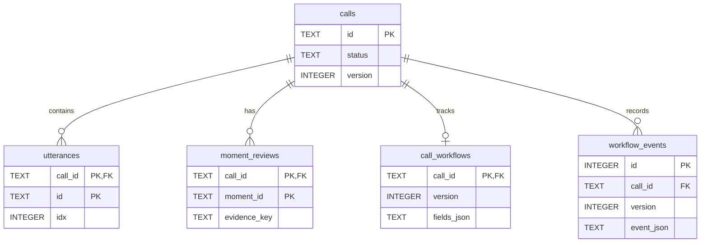

# Cơ sở dữ liệu ISEmoTalk: thiết kế, bảo toàn dữ liệu và cách bảo vệ

Cập nhật 23/11/2026. Tài liệu mô tả code trên nhánh `feat/thesis-demo-hardening-20261122`, schema version **1**. Đây là ứng dụng **QA sau cuộc gọi trên một máy**, chưa phải CRM/tổng đài nhiều doanh nghiệp. Xem [nghiệp vụ và kiến trúc](BUSINESS_ARCHITECTURE.md) và [biên bản kiểm tra](audits/database-20261123.md).

## 1. Dữ liệu nào lưu ở đâu?

| Thành phần | Nơi lưu | Lý do |
|---|---|---|
| Metadata cuộc gọi, transcript, dự đoán, đánh giá và hồ sơ xử lý | SQLite, mặc định `server/data/isemotalk.db` | Quan hệ giữa hồ sơ, khóa ngoại, truy vấn và transaction |
| Recording | `server/data/uploads/<callId>/audio.<ext>` | Phát/seek bằng HTTP Range; DB chỉ giữ tham chiếu tương đối |
| Gói model ASR/SER | Cache hoặc thư mục model riêng của Python | Trọng số không thuộc mỗi cuộc gọi, không nhét vào bảng hoặc bundle frontend |
| Mã/schema ứng dụng | Git | Có lịch sử thay đổi; không commit dữ liệu khách hàng hoặc model riêng |

`ISEMO_DATA_DIR` thay đổi thư mục dữ liệu; [config.ts](../server/src/config.ts) dựng đường dẫn DB/uploads. API và Python phải đọc được cùng recording. Trỏ inference sang một VPS khác không tự truyền file local sang máy đó.

## 2. ERD thực tế



Ba bảng kỹ thuật còn lại:

| Bảng | Khóa | Quan hệ và mục đích |
|---|---|---|
| `id_counters` | `name` | Giữ số cấp ID; không reset khi xóa hồ sơ |
| `audio_cleanup_jobs` | `call_id` | Ý định dọn recording sau xóa; **cố ý không có FK** vì phải còn sau khi `calls` đã bị xóa |
| `schema_migrations` | `version` | Ghi migration đã hoàn thành và thời điểm áp dụng |

Tổng cộng **8 bảng do ứng dụng quản lý**; SQLite có thể tạo bảng/index nội bộ, ví dụ `sqlite_sequence` cho AUTOINCREMENT. Những đối tượng nội bộ đó không phải thực thể nghiệp vụ.

Các bảng con liên kết tới `calls.id` bằng `ON DELETE CASCADE`. `call_workflows` có tối đa một dòng cho mỗi cuộc gọi; chưa nhập hồ sơ thì có thể chưa có dòng. `workflow_events` có nhiều phiên bản, với `UNIQUE(call_id, version)`. Mỗi utterance có khóa ghép `(call_id, id)` và `UNIQUE(call_id, idx)` để thứ tự trong cuộc gọi không trùng. Hai cuộc gọi khác nhau có thể cùng chứa `u0001`.

`moment_id` được suy ra từ quy tắc và câu neo, không tham chiếu tới một bảng moment vật lý. `evidence_key` gắn đánh giá với bằng chứng đã xem; khi bằng chứng thay đổi, API đánh dấu đánh giá cũ thay vì tự chuyển nó sang bằng chứng mới.

## 3. Từ điển dữ liệu

Nguồn đầy đủ: [DDL và migration](../server/src/db-schema.ts), [domain guards](../server/src/db-contract.ts), [DTO/repository](../server/src/repo.ts). `TEXT` chứa thời gian do API tạo/chuẩn hóa theo ISO 8601 UTC. Các số thời gian utterance là giây tính từ đầu recording; confidence là 0–1, không phải 0–100.

### `calls`

| Cột hoặc nhóm cột | Kiểu và ý nghĩa | Điều kiện chính |
|---|---|---|
| `id` | TEXT, ID nội bộ `CALL-0042` | PK không null/rỗng; không đồng nhất với contact ID tổng đài |
| `title`, `agent_name`, `customer_name` | TEXT, nhãn hiển thị/snapshot tên | NOT NULL; tên người không phải khóa định danh |
| `call_date`, `created_at`, `updated_at` | TEXT, ngày gọi/ngày tạo/cập nhật | Bắt buộc, API chuẩn hóa ngày; DB không kiểm chứng mọi định dạng lịch |
| `duration` | REAL, giây | Hữu hạn, ≥ 0; trước probe có thể là 0 |
| `audio_file`, `audio_name`, `audio_mime` | TEXT nullable, tham chiếu/tên/MIME recording | Hồ sơ nhập kết quả có thể không có audio; kiểm tra sở hữu đường dẫn ở tầng lưu file |
| `peaks`, `channels`, `agent_channel` | JSON array nullable; số kênh; kênh agent | Channels nguyên dương nếu có; agent_channel 0 hoặc 1 |
| `source` | TEXT | `upload`, `transcript_import`, `results_import` |
| `provenance` | TEXT nullable | `mock`, `real`, `imported`; không suy từ tên file |
| `speaker_source` | TEXT nullable | `channel`, `model`, `provided`, `mock`, `unassigned` |
| `status`, `stage`, `progress` | TEXT/TEXT nullable/INTEGER | Status `queued/processing/ready/failed`; stage theo pipeline; progress 0–100 |
| `error`, `attempts`, `stage_log` | TEXT nullable/INTEGER/JSON array | Attempts ≥ 0; stage_log giữ tiến độ/bằng chứng của các stage |
| `priority`, `dominant_emotion`, `negative_ratio` | Mức ưu tiên, cảm xúc chủ đạo, tỷ lệ | Priority `low/medium/high`; emotion thuộc 4 lớp hoặc null; tỷ lệ 0–1 |
| `moment_count`, `escalation_count`, `recovery_count`, `disagreement_count` | INTEGER, chỉ số tổng hợp | Nguyên không âm; dữ liệu suy ra từ utterance/luật |
| `avg_confidence` | REAL nullable | 0–1 nếu có |
| `review_status`, `overall_note`, `reviewed_at`, `version` | Trạng thái QA, ghi chú, thời điểm, phiên bản | Review `unreviewed/in_progress/reviewed`; version nguyên ≥ 1 |

### `utterances`

| Cột hoặc nhóm cột | Ý nghĩa và điều kiện |
|---|---|
| `call_id`, `id`, `idx` | FK/khóa ghép; idx nguyên ≥ 0 và duy nhất trong cuộc gọi |
| `speaker`, `text`, `start`, `end` | Vai `agent/customer/unknown`, nội dung, khoảng thời gian hữu hạn `0 ≤ start < end` |
| `orig_text`, `orig_speaker` | Bản gốc trước QA; nullable để tương thích dữ liệu cũ |
| `ac_emotion/ac_conf`, `lx_emotion/lx_conf`, `fu_emotion/fu_conf` | Cặp nhãn/xác suất acoustic, lexical, fused; cả cặp cùng null hoặc nhãn thuộc `neutral/happy/sad/angry` và confidence 0–1 |
| `agreement` | `high/partial/conflict` hoặc null; không giả lập hai nhánh còn thiếu của F4 |
| `review_decision`, `review_emotion`, `review_note` | Kết luận QA tách khỏi dự đoán; corrected cần nhãn hợp lệ; confirmed cần có fused prediction |
| `flagged` | INTEGER 0 hoặc 1 |

Sửa transcript/người nói giữ bản gốc và đánh dấu đầu vào dự đoán đã thay đổi. Chưa có lịch sử mọi lần sửa utterance, bảng annotation revision hay chạy lại SER theo text version. DB không tự chạy lại ML khi UPDATE.

### Các bảng còn lại

| Bảng | Cột | Nội dung |
|---|---|---|
| `moment_reviews` | `call_id`, `moment_id`, `relevance`, `note`, `evidence_key` | PK ghép; relevance null/0/1; đánh giá và dấu vết bằng chứng |
| `call_workflows` | `call_id`, `version`, `fields_json`, `updated_at` | Hồ sơ xử lý hiện tại, version ≥ 1; JSON object |
| `workflow_events` | `id`, `call_id`, `version`, `at`, `event_json` | PK INTEGER AUTOINCREMENT; một event cho mỗi phiên bản đã lưu; JSON object |
| `id_counters` | `name`, `value` | Value nguyên không âm; counter `calls` sống độc lập với xóa cuộc gọi |
| `audio_cleanup_jobs` | `call_id`, `created_at`, `attempts`, `last_error` | Công việc dọn file chưa xong; attempts nguyên không âm, lỗi cuối nullable |
| `schema_migrations` | `version`, `name`, `applied_at` | Nhật ký thay đổi schema đã commit |

`fields_json` hiện chứa: `externalContactId`, `ticketId`, `queueName`, `reason`, `resolution`, `nextAction`, `owner`, `followUpAt`, `outcomeNote`, `reviewerName`. API yêu cầu owner/việc tiếp theo/hạn khi hẹn follow-up, và kết quả khi resolved. DB kiểm tra object JSON/version; các điều kiện nghiệp vụ trong JSON được kiểm tra bởi [workflow.ts](../server/src/workflow.ts).

Event mới có `schemaVersion: 2` và `snapshot` đủ toàn bộ các trường đã chuẩn hóa. **Đây là phiên bản định dạng event, khác schema database version 1.** Event cũ thiếu một số trường được trả về với `snapshotStatus: legacy_partial`; bytes cũ không bị viết lại. Không thể tái tạo giá trị lịch sử chưa từng lưu. Tên reviewer hiện là thông tin tự khai, chưa phải danh tính xác thực.

## 4. Chuẩn hóa: nói đúng mức đã làm

Khóa `calls.id` xác định thông tin của một cuộc gọi; `(call_id, id)` xác định một utterance; `(call_id, version)` xác định một workflow event. Tách utterance khỏi call tránh một cột chứa cả danh sách câu và tránh lặp metadata cuộc gọi cho từng câu. Khóa ngoại kiểm soát quan hệ tồn tại. Đây là phần thiết kế quan hệ cần giải thích trước khi nói đến giao diện.

Không tuyên bố toàn bộ physical schema đạt 3NF:

- `calls` giữ các tổng hợp như priority, negative_ratio, moment_count để phục vụ danh sách/filter. Đây là dữ liệu tính sẵn. `refreshDerived` cập nhật chúng cùng transaction của review hoặc stage hoàn tất. Script SQL ngoài API có thể làm tổng hợp lệch dù giá trị vẫn nằm trong miền hợp lệ; `db:check` hiện chưa tính lại mọi chỉ số để đối chiếu.
- Workflow form và snapshot history nằm trong JSON. Cách này hỗ trợ một hồ sơ nhỏ, nhưng không cung cấp FK tới nhân viên/nhóm/ticket hoặc index cột cho các trường bên trong. Snapshot cố ý lặp dữ liệu theo thời điểm để kiểm tra lịch sử.
- `agent_name/customer_name/queueName/owner` là nhãn/snapshot, chưa phải các thực thể master-data được chuẩn hóa. Đổi tên nhân viên không tự đổi mọi bản ghi cũ.

Khi triển khai nhiều người dùng hoặc tích hợp CRM, mục tiêu nâng cấp có căn cứ là tách `users/agents`, `teams/queues`, `contacts`, `cases/tickets`, liên kết call–case, `recording_assets`, `inference_runs`, `model_versions`, `annotation_revisions`. Cần định nghĩa FK, uniqueness theo nhà cung cấp, quyền truy cập và migration theo nhu cầu thật. Không tạo bảng rỗng để tăng số lượng bảng trong đồ án.

## 5. Toàn vẹn ở nhiều lớp

API kiểm tra request trước; DB vẫn phải từ chối các giá trị sai khi có script khác ghi trực tiếp. Bản mới áp dụng cùng một contract SQL cho CHECK trên bảng mới, INSERT/UPDATE trigger cho bảng cũ, và kiểm tra dữ liệu đã lưu. Bao gồm ID không null/rỗng, enum, số hữu hạn, khoảng thời gian, confidence, boolean, cặp prediction và kiểu JSON cơ bản. `COALESCE(...,0)` tránh việc biểu thức SQL NULL vô tình vượt qua điều kiện.

Lý do cần explicit NOT NULL: SQLite có ngoại lệ lịch sử cho TEXT PRIMARY KEY trên bảng thường. CHECK cũng chấp nhận biểu thức trả về NULL nếu không xử lý rõ. [SQLite CREATE TABLE](https://www.sqlite.org/lang_createtable.html). Foreign key phải được bật cho mỗi connection; ứng dụng đặt `PRAGMA foreign_keys=ON` trong `openDb`, không dựa vào mặc định của driver. [SQLite foreign keys](https://www.sqlite.org/foreignkeys.html).

`integrity_check` kiểm tra cấu trúc và những constraint SQLite biết; nó không tự biết toàn bộ luật nghiệp vụ của ứng dụng. `foreign_key_check` kiểm tra dòng mồ côi, nhưng không phát hiện một FK chưa từng được khai báo. Vì vậy diagnostic còn kiểm tra cột/PK/FK/index/schema version, domain predicates và trạng thái file. Không gọi một database “đúng nghiệp vụ” chỉ vì `integrity_check` trả `ok`.

SQL nhận dữ liệu người dùng thông qua parameter binding. Biểu thức sort chọn từ allowlist. Tìm kiếm literal `\\`, `%`, `_` đã có regression test; đây là sửa ngữ nghĩa LIKE, không phải bằng chứng từng có SQL injection.

## 6. Transaction, đồng thời và phục hồi

| Thao tác | Các thay đổi nằm trong một transaction | Khi lỗi |
|---|---|---|
| Lưu QA | Kiểm tra baseVersion, sửa utterance/moment, tính tổng hợp, tăng version | Rollback toàn bộ; xung đột version trả 409 |
| Lưu hồ sơ xử lý | Kiểm tra version, cập nhật form, thêm event đầy đủ | Event ghi lỗi thì form/version cũng rollback |
| Hoàn tất stage | Output stage và checkpoint hoàn tất | Không giữ output nửa chừng với checkpoint không khớp |
| Xóa cuộc gọi | Xóa cha/con theo FK và thêm audio cleanup job | Ghi job lỗi thì relational delete rollback |
| Migration | Kiểm tra legacy, thêm cột/bảng/guard/index, ghi migration version | Lỗi thì schema/rows trong transaction rollback; không âm thầm chữa dữ liệu |

Hai tab lấy cùng version 4: tab B lưu thành 5; tab A gửi baseVersion 4 sẽ bị từ chối, draft được giữ. Review version và workflow version độc lập vì chúng sửa hai phần hồ sơ khác nhau. Đây là optimistic concurrency cho phạm vi hiện tại, chưa phải protocol điều phối nhiều worker.

File SQLite dùng WAL, busy timeout 5 giây và `synchronous=FULL`. WAL hỗ trợ đọc cùng lúc ghi nhưng vẫn chỉ một writer tại một thời điểm; không đặt database WAL trên filesystem mạng hoặc đồng bộ sống bằng Drive. [SQLite WAL](https://www.sqlite.org/wal.html). Ứng dụng hiện dùng một API/một hàng đợi tuần tự; chưa có job lease phân tán. `FULL` là cấu hình durability của SQLite, không phải cam kết thiết bị/hệ điều hành không thể mất dữ liệu.

### Ranh giới giữa DB và audio

SQLite không rollback được thao tác xóa file. Vì vậy DELETE thực hiện:

1. Kiểm tra recording thuộc đúng `uploads/<callId>`; chặn traversal, root, thư mục cuộc gọi khác và symlink thoát ra ngoài. Sai thì trả 409 trước khi xóa.
2. Trong một transaction, xóa record/con và lưu ý định dọn file.
3. Sau commit, hủy job đang chạy và thử dọn thư mục thuộc cuộc gọi.
4. Nếu Windows khóa file hoặc thiếu quyền, giữ cleanup job với attempts/lỗi cuối. HTTP 204 xác nhận **xóa hồ sơ logic** đã commit; không tuyên bố byte audio chắc chắn đã biến mất.
5. Startup API thử lại từng job một lần. `db:check` báo các job còn lại; nó không tự xóa file.

Đây là cơ chế xử lý file sau commit có thể thử lại. Thời điểm mất điện đúng giữa hai bước chưa được thử trên phần cứng; tests dùng chèn lỗi và khởi tạo lại app. Không gọi đây là transaction phân tán hay xóa dữ liệu an toàn cấp thiết bị.

## 7. Index và hiệu năng có bằng chứng

| Truy vấn | Index/khóa phục vụ |
|---|---|
| `WHERE call_id=? ORDER BY idx` | Unique index `idx_utterances_call_order(call_id,idx)` |
| Workflow `WHERE call_id=? ORDER BY version DESC` | Autoindex của `UNIQUE(call_id,version)`, có thể đọc ngược |
| Sắp theo ngày gọi | `idx_calls_date(call_date)` |
| Lọc priority | `idx_calls_priority(priority)` |
| Tra cứu ID/quan hệ con | PK và các composite index bắt đầu bằng `call_id` |

Đã kiểm tra `EXPLAIN QUERY PLAN` cho utterance order, lịch sử workflow và call date trên fixture; SQLite chọn index tương ứng. Hai index cũ trùng chức năng được bỏ trong migration. Đây là bằng chứng chọn index, **không phải benchmark độ trễ hoặc sức chứa sản xuất**.

Search `LIKE '%term%'` vẫn có thể scan; analytics/export hiện còn tổng hợp đồng bộ trong Node và giữ output trong memory. Đo trên số lượng cuộc gọi mục tiêu trước khi thêm FTS, background export hoặc chuyển engine. Không có bằng chứng bottleneck hiện tại cần Rust/PostgreSQL.

## 8. Migration và kiểm tra trên laptop

Schema mới được quản lý tập trung tại `openDb`, không phụ thuộc việc attach HTTP routes. Legacy version 0 được nâng bằng transaction sau khi kiểm tra dữ liệu. Bản mới kiểm tra cột ứng dụng cần, PK/FK cascade, uniqueness và đối tượng guard/index; kiểm tra lại sau khi cài rồi mới ghi version. Index cũ trùng tên nhưng sai định nghĩa không được âm thầm làm migration “thành công”. Schema từ phiên bản mới hơn bị từ chối, không tự downgrade.

```powershell
npm run db:check
npm run --silent db:check -- --json | Set-Content -Encoding UTF8 db-check-result.json
```

`--silent` tránh npm chèn banner vào file JSON. Có thể truyền `--db D:\ISEmoTalkData\isemotalk.db --uploads D:\ISEmoTalkData\uploads`. Nếu DB chưa tồn tại, checker báo lỗi và không tạo file/thư mục. Version 0 trên dữ liệu cũ là trạng thái cần migration, chưa phải bằng chứng dữ liệu hỏng. Nếu chỉ thiếu migration, backup rồi khởi động API mới; nếu có domain/FK/path failure, giữ nguyên dữ liệu và xem báo cáo trước khi sửa.

Exit 0: các lớp đang kiểm tra đều đạt. Exit 1: cần đọc chi tiết; có thể là thiếu file, legacy schema, cleanup chưa xong hoặc vấn đề dữ liệu. Báo cáo không xuất transcript/tên khách hàng; chỉ có số lượng, rowid/call ID, schema và lỗi kỹ thuật. Connection được mở read-only; SQLite có thể sử dụng file WAL/SHM đi kèm khi đọc database đang hoạt động. Kiểm thử trên file đã đóng xác nhận nội dung file DB không đổi.

## 9. Backup và restore có thể giải thích

Đối với buổi báo cáo local:

1. Dừng web/API/inference, đóng cả công cụ đang mở DB; xác nhận không còn ghi dữ liệu.
2. Copy **toàn bộ** thư mục dữ liệu thực tế (mặc định `server/data`) sang vị trí mới có đủ chỗ. Giữ recording cùng DB; nếu WAL/SHM còn tồn tại sau dừng, giữ chúng cùng snapshot, không tự xóa bằng tay.
3. Ghi nhánh/commit, cấu hình runtime đã chọn và vị trí model riêng. Không commit `.env`, dữ liệu hoặc trọng số vào repo web.
4. Thử phục hồi vào **một thư mục mới**; chạy `db:check --db ... --uploads ...`, kiểm tra số call/utterance/history và mở một recording. Không ghi đè bản đang dùng để “thử backup”.
5. Chỉ trỏ `ISEMO_DATA_DIR` sang bản phục hồi khi đã kiểm tra. Khôi phục DB không đồng nghĩa đã khôi phục Python/weights.

Test có kiểm tra copy dữ liệu khi đã đóng DB, mở bản phục hồi, đối chiếu row/workflow và bytes recording. Chưa thử khôi phục từ sự cố ổ cứng hay backup dữ liệu thật trên laptop. Khi cần backup online, dùng SQLite backup API cho DB và thiết kế snapshot/versioning riêng cho audio; copy mỗi `.db` đang ghi hoặc chỉ xuất CSV/JSON không bảo đảm đầy đủ ứng dụng. [SQLite backup API](https://www.sqlite.org/backup.html).

## 10. Những câu trả lời nên dùng khi bảo vệ

**“Tại sao chọn SQLite?”** Phạm vi một máy, một API, QA sau cuộc gọi; cần transaction và truy vấn quan hệ, chạy offline dễ. Chọn theo workload và cách triển khai; không tuyên bố SQLite luôn nhanh hơn một DB server.

**“CSDL của em có chuẩn hóa không?”** Giải thích khóa và quan hệ core; chỉ rõ các summary là dữ liệu suy ra và workflow snapshot là JSON có chủ đích. Đưa ra hướng tách master-data/revisions khi có nhiều người dùng, thay vì nói mọi bảng đều 3NF.

**“Model dự đoán sai thì em sửa đè à?”** Không. Các cột prediction giữ output model; cột review giữ kết luận người kiểm tra. Text/role gốc được giữ. Lịch sử mọi lần sửa annotation và rerun theo text version là phần chưa hoàn thiện.

**“Hai người sửa cùng lúc?”** Có baseVersion/409 cho hai luồng review và workflow; có test. Chưa có xác thực user/role hay điều phối nhiều API instance, nên không mở public như một hệ thống doanh nghiệp hoàn chỉnh.

**“Xóa call mà audio không xóa được?”** Record và cleanup intent commit cùng nhau; file được thử dọn sau commit, thất bại còn job để kiểm tra/thử lại. Không để một HTTP 500 che việc DB đã xóa xong.

**“Em chứng minh tính đúng bằng gì?”** ERD và contract; test direct SQL sai; legacy migration rollback; fault injection cho save/history/checkpoint/delete; query plan; backup round-trip; rồi kiểm tra dataset thật trên máy trình bày. Test phần mềm không chứng minh accuracy SER.
